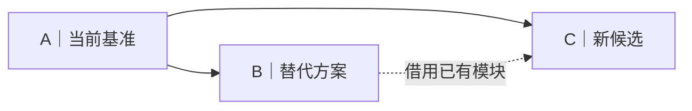

# 项目版本谱系

用来回答一个方案从哪里分出、改变了什么、为何继续或归档。先核对现有方案、运行配置与结果、提交记录和发布或稿件说明。沿用已有标识和文档位置，依据不足的关系标为待核实。

- **按决策粒度记节点。** 研究问题、核心方案或影响结果解释的评估协议有实质变化时，视需要增加节点。普通提交、重复运行、种子和同方案续接留在已有记录。记录中的版本身份、运行是否完成、结论强弱和是否可复跑分别说明。
- **标清关系和证据。** 从来源指向派生方案或使用该来源的方案，区分基准继承、局部复用和结果启发。存在多个来源时，分别写明从哪个基准出发、借用了哪个模块。评价使用的对照单独记录。若复用的是结构、权重、数据或已有运行结果，写到相应粒度。重要关系链接具体方案、配置或产物，已知提交或冻结配置时用其固定版本。日期用于了解顺序，派生关系由来源证据支持。代码提交和任务阻塞各沿用已有 Git 与任务记录。
- **记录继续条件与取舍。** 新候选写明问题、起点、关键变化与对照，必要时明确什么证据支持继续。阶段收束时记录采用、暂缓或归档的理由，说明哪些局部成果仍可复用。标明当前工作基准和发布或稿件实际采用的方案与结果。选择采用依据证据与目标，允许回到更早的基准继续。

项目已有索引可容纳时直接更新。需要图时，在同一 Markdown 文件中用 Mermaid `flowchart`，图下链接详细记录。节点多时，主图保留有决策意义的分叉，配置组合和运行明细可在各方案下展开。图本身为索引，项目事实、产物与结论保留在已有来源中。

上例中 C 以 A 为起点，另从 B 借用一个模块，B 的其他改动沿各自记录解释。交付前核对节点身份、边的方向与类型、证据链接、当前采用决定和实际阅读效果。可直接在 GitHub 的 Markdown 页面预览。[GitHub Mermaid 渲染说明](https://docs.github.com/en/get-started/writing-on-github/working-with-advanced-formatting/creating-diagrams)
