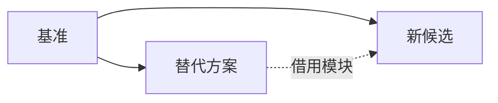

# 项目版本谱系

- **只画影响决策或结果解释的版本。** 沿用项目标识。种子、重跑和续训留在运行记录。
- **区分继承、借用和结果启发。** 从来源连到新方案，链接方案、提交或结果。证据不足时标为待核实。
- **记录问题、改动和取舍。** 拟议方案写继续条件，完成后记结果与采用、暂缓或归档的依据。标出当前基准及论文或发布采用的版本。
- **复用已有 Markdown 索引。** 按需用 Mermaid 展示分叉，图下链接证据。核对边的方向和链接。[GitHub Mermaid 文档](https://docs.github.com/en/get-started/writing-on-github/working-with-advanced-formatting/creating-diagrams)

